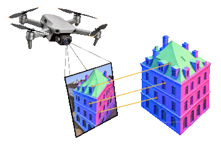
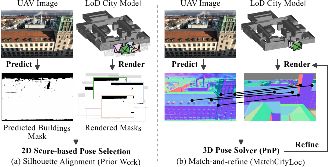

<div align="center">



<h1>MatchCityLoc: Aerial Localization in LoD City Models via Surface Normal Matching</h1>
<h2>WACV 2027</h2>

<p>
  <a href="https://tum-vision.github.io/MatchCityLoc/"></a>
  <a href="https://youtu.be/TWEFaWydEU8"></a>
  
  <a href="datasets/README.md"></a>
  <a href="LICENSE"></a>
</p>

<p align="center">
  <a href="https://ussaema.github.io">Oussema Dhaouadi</a><sup>1,2,3,4</sup>,
  <a href="https://zuriabauer.com/">Zuria Bauer</a><sup>3</sup>,
  <a href="https://www.linkedin.com/in/johannes-meier-52a159b4/">Johannes Meier</a><sup>2,4</sup>,<br>
  <a href="https://cvg.ethz.ch/team/Prof-Dr-Marc-Pollefeys">Marc Pollefeys</a><sup>3,5</sup>,
  <a href="https://cvg.cit.tum.de/members/cremers">Daniel Cremers</a><sup>2,4</sup>,
  <a href="https://olafwysocki.github.io/">Olaf Wysocki</a><sup>1</sup>
</p>

<p><sup>1</sup> University of Cambridge &nbsp; <sup>2</sup> TU Munich &nbsp; <sup>3</sup> ETH Zurich<br>
<sup>4</sup> MCML &nbsp; <sup>5</sup> Microsoft</p>

</div>

<p align="center">
  
</p>

MatchCityLoc refines a noisy camera-pose prior against a textureless **LoD city model** by matching **surface normals**. It uses pretrained models without dataset-specific training.

Experiments demonstrate strong pose recall and accurate translation and rotation among the evaluated off-the-shelf LoD-based methods. These findings support accurate urban UAV localization using lightweight city geometry, without textured maps or dataset-specific training.

## 🚀 How it works

1. **Predict normals** from a calibrated UAV image with MoGe-2.
2. **Render normals and depth** from the city model at the current pose.
3. **Match normal maps** using MINIMA (RoMa), then lift matches to 3D using rendered depth.
4. **Refine the camera pose** with PnP-RANSAC and repeat.

```
GPS prior → render LoD normals → dense normal matching → PnP → iterate
```

---

## 🛠️ Installation

Linux and an NVIDIA GPU are required. We use Python 3.10, PyTorch 2.6, and CUDA 12.4.

```bash
git clone https://github.com/tum-vision/MatchCityLoc.git
cd MatchCityLoc

conda create -n matchcityloc python=3.10 -y
conda activate matchcityloc
conda install -y -c nvidia cuda-nvcc=12.4.131 cuda-cudart-dev=12.4.127
conda install -y -c conda-forge cxx-compiler

pip install torch==2.6.0 torchvision==0.21.0 --index-url https://download.pytorch.org/whl/cu124
pip install setuptools wheel ninja
pip install -r requirements.txt
pip install git+https://github.com/NVlabs/nvdiffrast.git@abb07ca0358f3a21c3942b50c54aa1eacd329af9 --no-build-isolation
GIT_LFS_SKIP_SMUDGE=1 pip install --no-deps git+https://github.com/microsoft/MoGe.git@07444410f1e33f402353b99d6ccd26bd31e469e8
```

Check the installation:

```bash
python - <<'PY'
import torch
import nvdiffrast.torch
from moge.model.v2 import MoGeModel
print(f"PyTorch {torch.__version__}; CUDA available: {torch.cuda.is_available()}")
assert torch.cuda.is_available(), "A CUDA-capable GPU is required"
PY
PYTHONPATH=. python pipeline_matching.py --help
```

Model weights are downloaded automatically on first use. For other CUDA/PyTorch combinations, install a compatible PyTorch build before `requirements.txt`.

## 📊 Data

### SemCityLockeD

Download and prepare the complete public release automatically:

```bash
python scripts/prepare_semcitylocked.py data/SemCityLockeD
```

This creates a runnable dataset from the public DJI images and automatically verifies the models and annotations. The public images require approximate rectification; exact paper reproduction requires the original 937 rectified images. See [dataset details](datasets/SemCityLockeD/README.md).

### UAVD4L-LoDv2 and Swiss-EPFLv2

Download both datasets from the [LoD-Loc release](https://github.com/VictorZoo/LoD-Loc) ([Baidu archive](https://pan.baidu.com/s/1Ue37i0OQpS2jzo-fQ3o4bA?pwd=xxdv), code `xxdv`), copy the extracted dataset folders under `data/`, and convert the meshes:

```bash
mkdir -p data/MODEL/ply
PYTHONPATH=. python utils/obj_to_ply.py /path/to/MODEL/UAVD4L-LoD.obj data/MODEL/ply/UAVD4L-LoD3.ply
PYTHONPATH=. python utils/obj_to_ply.py /path/to/MODEL/Swiss-EPFL-LoD.obj data/MODEL/ply/Swiss-EPFL-LoD2.ply
```

More details are available in [datasets/README.md](datasets/README.md).

## ▶️ Quick start

Run a one-frame smoke test:

```bash
PYTHONPATH=. python -u pipeline_matching.py \
    --dataset uavd4l --split inTraj --data_root data/UAVD4L-LoD/inTraj \
    --mesh_path data/MODEL/ply/UAVD4L-LoD3.ply \
    --num_iterations 1 --n 1 --batchsize 8 \
    --out outputs/smoke_test
```

The run is successful when it reaches `MATCHING PIPELINE COMPLETED` and writes `outputs/smoke_test/metrics.json`. The first execution is slower because MoGe-2 and MINIMA weights are downloaded.

Evaluate SemCityLockeD with the paper settings:

```bash
PYTHONPATH=. python -u pipeline_matching.py \
    --dataset semcitylocked --data_root data/SemCityLockeD \
    --mesh_path data/SemCityLockeD/model/TUM_CC_lod3.obj \
    --num_iterations 5 \
    --out outputs/eval_semcity_lod3
```

Use `python pipeline_matching.py --help` for dataset, matcher, modality, and ablation options. Example cluster launchers are provided in [slurm/](slurm/README.md). Set the partition and resource limits for your cluster, and choose the iteration count for the evaluation protocol you intend to run.

The paper's SemCityLockeD comparison uses 937 rectified queries. Published SemCityLoc results follow their original evaluation protocol and report mean translation and yaw errors, unlike our median translation and full-rotation errors.

## 📁 Repository contents

`main` contains the localization and ablation pipelines, configurations, dataset adapters and preparation scripts, evaluation utilities, and vendored matching code. Model weights and dataset images are downloaded separately. The small SemCityLockeD pose and calibration annotations are included with source attribution.

The [project page](https://tum-vision.github.io/MatchCityLoc/) is maintained on the [`gh-pages`](https://github.com/tum-vision/MatchCityLoc/tree/gh-pages) branch.

## 🙏 Acknowledgments

This implementation builds on [MoGe-2](https://github.com/microsoft/MoGe), [MINIMA](https://github.com/LSXI7/MINIMA), [RoMa](https://github.com/Parskatt/RoMa), [Image Matching WebUI](https://github.com/Vincentqyw/image-matching-webui), and [nvdiffrast](https://github.com/NVlabs/nvdiffrast). See [third-party notices](THIRD_PARTY.md) for the bundled components and their licenses.

## 📜 Citation

```bibtex
@inproceedings{dhaouadi2027matchcityloc,
  title     = {{MatchCityLoc}: Aerial Localization in {LoD} City Models via Surface Normal Matching},
  author    = {Dhaouadi, Oussema and Bauer, Zuria and Meier, Johannes and Pollefeys, Marc and Cremers, Daniel and Wysocki, Olaf},
  booktitle = {IEEE/CVF Winter Conference on Applications of Computer Vision (WACV)},
  year      = {2027}
}
```

---

## ⚖️ License

This code is released under [CC BY-NC 4.0](LICENSE) (non-commercial). Third-party components retain their original licenses.
